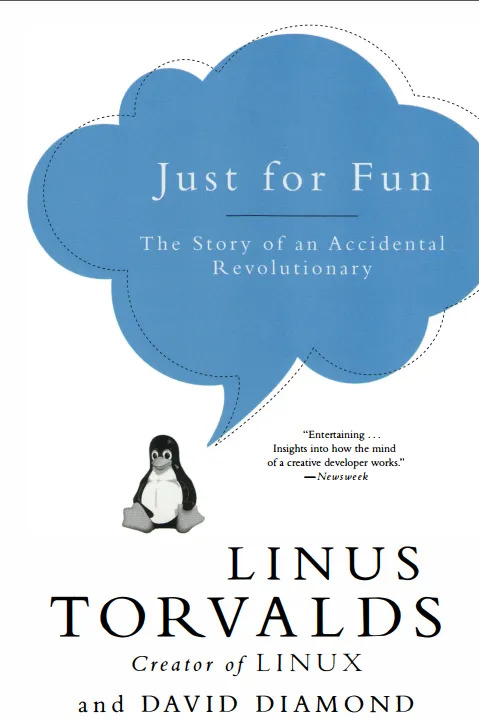

<div align="center">



# 🐧 فقط برای تفریح: داستان یک انقلابی اتفاقی
### Just for Fun: The Story of an Accidental Revolutionary

**نویسندگان:** لینوس توروالدز و دیوید دیاموند  
**مترجم:** جادی میرمیرانی و جامعه متن‌باز ایران  

[](LICENSE.md)
[](https://github.com/jadijadi/justforfun)
[](http://makeapullrequest.com)
[](https://hheydarian.github.io/Gitab/books/book10/)

</div>

---

<div dir="rtl">

## 📖 درباره کتاب

کتاب **«فقط برای تفریح: داستان یک انقلابی اتفاقی»** (*Just for Fun: The Story of an Accidental Revolutionary*) اثر خودنوشت و ماندگار **لینوس توروالدز** (خالق کرنل لینوکس و سیستم کنترل نسخه گیت) با همکاری روزنامه‌نگار برجسته **دیوید دیاموند** است.

این اثر با لحنی بسیار صمیمی، طنز، بی‌پرده و جذاب، مسیر زندگی پسربچه‌ای آرام و گوشه‌گیر از هلسینکی فنلاند را روایت می‌کند که کارش را از بازی با میکروکامپیوتر سینکلر پدربزرگش آغاز کرد و صرفاً «برای تفریح و کنجکاوی» هسته سیستم‌عاملی را پایه‌گذاری نمود که امروزه ستون فقرات سرورها، اَبَررایانه‌ها، گوشی‌های اندرویدی و اینترنت سراسر جهان را تشکیل می‌دهد.

پیام فلسفی محوری کتاب، تئوری سه مرحله‌ای انگیزش انسانی از نگاه لینوس است:
> **«همه چیز در زندگی با بقا آغاز می‌شود، به جایگاه اجتماعی پیوند می‌خورد و در نهایت به اوج خود یعنی "تفریح و اشتیاق محض" می‌رسد.»**

---

## 📚 سرفصل‌ها و فهرست کامل کتاب

این اثر در **۳۸ بخش و سرفصل** مدون شده است:

### 🌟 پیش‌درآمد
- **مقدمه:** معنای زندگی یک (سکس، جنگ، لینوکس)

### 💻 بخش اول: تولد یک نِرْد (Birth of a Nerd)
- **بخش ۱:** کودکی، دندان‌های پیش‌آمده و دماغ بزرگ توروالدزی
- **بخش ۲:** پدربزرگ و اولین کامپیوتر (Commodore VIC-20)
- **بخش ۳:** جادوی کد ماشین و ورود به دنیای اسمبلی
- **بخش ۴:** مدرسه، انزوا و کشف ریاضیات
- **بخش ۵:** روزگار نوجوانی و کامپیوتر Sinclair QL
- **بخش ۶:** خدمت سربازی و دانشگاه هلسینکی
- **بخش ۷:** آشنایی با یونیکس و آغاز یک رویا

### ⚙️ بخش دوم: تولد یک سیستم‌عامل (Birth of an OS)
- **بخش ۱:** خرید کامپیوتر ۳۸۶ و مواجهه با مینیکس (Minix)
- **بخش ۲:** نوشتن شبیه‌ساز ترمینال و ور رفتن با سخت‌افزار
- **بخش ۳:** ارسال ایمیل تاریخی به گروه comp.os.minix: «من دارم یک سیستم‌عامل آزاد می‌نویسم...»
- **بخش ۴:** نام‌گذاری لینوکس و میزبانی در سرور FTP دانشگاه فنلاند
- **بخش ۵:** اولین مشارکت‌کنندگان جهانی و پچ‌های پستی
- **بخش ۶:** مناظره داغ و مشهور با پروفسور اندرو تننبام (میکروکرنل در برابر مونولیتیک)
- **بخش ۷:** پذیرش مجوز گنو (GPL v2)؛ نجات‌بخش‌ترین تصمیم تاریخ
- **بخش ۸:** توسعه درایورها و رشد باورنکردنی جامعه
- **بخش ۹:** ظهور توزیع‌های اولیه (اسلکور و دبیان)
- **بخش ۱۰:** پنگوئن Tux چطور نماد لینوکس شد؟
- **بخش ۱۱:** انتشار نسخه ۱.۰ و هیاهوی رسانه‌ها
- **بخش ۱۲:** تولد بنیاد لینوکس و گسترش جهانی

### 🎩 بخش سوم: فرش قرمز (The Ball)
- **بخش ۱:** مهاجرت به سیلیکون‌ولی و شرکت ترانسمتا (Transmeta)
- **بخش ۲:** دیدار محرمانه با استیو جابز و رد پیشنهاد وسوسه‌انگیز اپل
- **بخش ۳:** ظهور رد هت (Red Hat) و حضور در بورس وال‌استریت
- **بخش ۴:** ثروت غیرمنتظره و حفظ فروتنی
- **بخش ۵:** خانواده، توبه و فرزندان در کالیفرنیا
- **بخش ۶:** مدیریت ایمیلی پروژه و فلسفه هدایت بدون دیکتاتوری
- **بخش ۷:** جنگ مرورگرها و ورود غول‌ها (IBM، Oracle، HP)
- **بخش ۸:** روزگار دادگاه‌ها، مایکروسافت و مفهوم رقابت
- **بخش ۹:** سفرها، جوایز بین‌المللی و سخنرانی‌های پرشور
- **بخش ۱۰:** مواجهه با فرهنگ سلبریتی و شهرت ناخواسته
- **بخش ۱۱:** غواصی، تفریح و رهایی از استرس
- **بخش ۱۲:** تثبیت لینوکس به عنوان موتور محرک سیاره زمین

### 🧭 بخش چهارم: پایان‌ها و افق‌های فکری
- **دارایی معنوی:** مالکیت فکر، کپی‌رایت و بازتعریف حق نشر
- **پایانی بر کنترل:** چرا هیچ شرکتی نباید صاحب انحصاری سیستم‌عامل باشد
- **راه جذاب پیش رو:** چشم‌انداز آینده تکنولوژی و نرم‌افزار
- **چرا متن‌باز مهم است:** مدل توسعه باز، شفافیت و خرد جمعی
- **شهرت و ثروت:** ارزش واقعی پول در برابر آزادی عمل
- **معنای زندگی ۲:** بازگشت به آغاز، عشق، خانواده و تفریح بی‌پایان

---

## 🚀 شیوه‌های دسترسی و مطالعه

شما می‌توانید این کتاب را به روش‌های متنوع مطالعه نمایید:

1. **مطالعه آنلاین با رابط کاربری مدرن:**
   - مطالعه مستقیم در [پلتفرم آزاد گیتاب (Gitab)](https://hheydarian.github.io/Gitab/books/book10/) با قابلیت ذخیره وضعیت مطالعه، تم شب/روز و فونت خوانای وزیرمتن.
2. **دریافت نسخه الکترونیکی آفلاین:**
   - دانلود [نسخه PDF فارسی](content/extra/justforfun_persian.pdf)
   - دانلود [نسخه ePub فارسی (مناسب بوک‌خوان‌ها و موبایل)](content/extra/justforfun_persian.epub)
   - دانلود [نسخه Mobi (ویژه کیندل)](content/extra/justforfun_persian.mobi)

---

## 🛠️ ساخت و اجرای لوکال پروژه

این پروژه با پایتون و موتور سایت‌ساز استاتیک **Pelican** توسعه داده شده است.

```bash
# کلون کردن مخزن
git clone https://github.com/jadijadi/justforfun.git
cd justforfun

# ساخت محیط مجازی و نصب وابستگی‌ها
python -m venv venv
source venv/bin/activate  # در لینوکس و مک
# یا در ویندوز: venv\Scripts\activate
pip install -r requirements.txt

# ساخت و اجرای سرور توسعه
./develop_server.sh restart 8000
```
سپس مرورگر خود را باز کرده و به آدرس `http://localhost:8000` مراجعه فرمایید.

---

## 🤝 مشارکت در بهبود ترجمه

این پروژه یک تلاش جمعی و آزاد است. اگر در خوانش متن به غلط املایی، نگارشی یا جمله نامفهومی برخوردید:
1. مخزن را فورک (Fork) کنید.
2. فایل مربوط به آن فصل در پوشه `content/chapters/` را ویرایش نمایید.
3. یک Pull Request تمیز ارسال بفرمایید.

پیشنهادات اساسی را خوشحال می‌شویم ابتدا در بخش [Issues](https://github.com/jadijadi/justforfun/issues) مطرح نمایید.

---

## 📜 لایسنس و حق نشر

این اثر تحت مجوز **Creative Commons Attribution-ShareAlike 4.0 (CC BY-SA 4.0)** منتشر شده است و تکثیر، بازنشر و استفاده از آن با ذکر منبع و تحت همین شرایط آزاد است.

</div>
